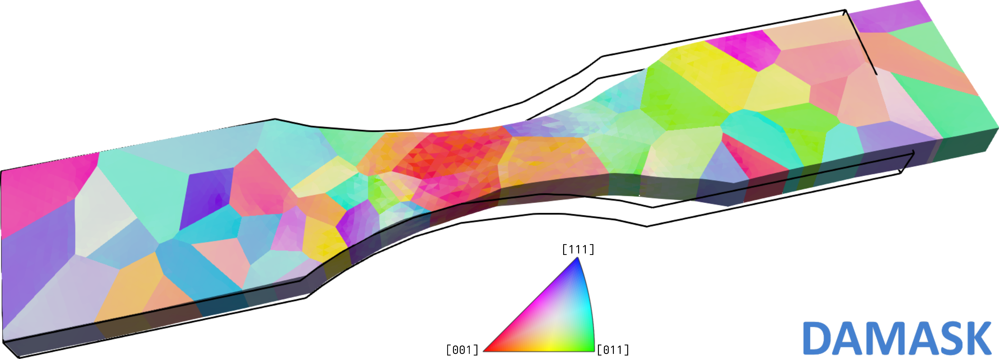

# Summary
\texttt{DAMASK}^®^ is a multiphysics simulation package for studying the deformation behavior of crystalline materials subjected to thermo--chemo--mechanical loads [@RotersEtAl2019].
It contains models for mechanics, including anisotropic elasticity, crystal plasticity, and general inelastic deformations, as well as formulations for temperature evolution, fracture, and chemical diffusion.
The modular structure of \texttt{DAMASK} allows using it with different solvers.
While for hexahedral domains represented by regular voxel grids and subjected to periodic boundary conditions an open source framework is included in \texttt{DAMASK} since its first public release in 2011 [@ShanthrajEtAl2019], commercial Finite Element Method (FEM) solvers such as \texttt{MSC Marc} are needed for complex-shaped geometries and unstructured meshes [@GallardoBasileEtAl2023].
Here, we present an open source FEM-based solver for such situations.

{ width=80% }

# Statement of need
\texttt{DAMASK} has been used in a plethora of studies, mainly related to micromechanics of engineering alloys [@RotersEtAl2019; @DiehlEtAl2020].
Most of these studies use a fast spectral solver from the so-called \texttt{grid} framework despite its restriction to hexahedral domains, regular grids, and peridodic boundary conditions.
Notwithstanding progress in relaxing these restrictions [@RisthausEtAl2024; @PauxEtAl2025], FEM-based solvers are better suited for complex geometries and boundary conditions, e.g. when simulating nano-indentation [@GallardoBasileEtAl2023].
To this end, commercial FEM solvers such as \texttt{Abaqus} [@MeierEtAl2014], \texttt{LS-DYNA} [@Ma2019] or \texttt{MSC Marc} [@GallardoBasileEtAl2023] can be coupled to \texttt{DAMASK}.
However, the limited programming interfaces provided by these software packages, their cumbersome installation procedure, and the license fees required to use them are major obstacles that impede the wider use of \texttt{DAMASK} with FEM solvers.
The \texttt{mesh} solver addresses the need for an integrated open source FEM solver with a simple installation procedure and the possibility to handle unstructured meshes, arbitrarily shaped-geometries, and complex boundary conditions, as shown in figures \ref{tensile} and \ref{bending}.
Currently, only mechanics is considered but extension to other fields, in particular temperature, is foreseen.
Another missing feature that motivates the ongoing support of \texttt{MSC Marc} is contact mechanics.

# State of the field
A review on free and open source general purpose FEM frameworks would be beyond the scope of this paper.
The solvers of the Portable, Extensible Toolkit for Scientific Computation (\texttt{PETSc}) [@BalayEtAl2026] can be used by many of these frameworks, for example in \texttt{FreeFEM} [@Hecht2012] and \texttt{deal.II} [@ArndtEtAl2021].
The FEM and mesh infrastructure of \texttt{PETSc} [@knepleybrownruppsmith13; @LangeEtAl2016] is, however, less often used.

Crystal plasticity constitutive models, initially used in mean-field schemes, have been successfully coupled to full-field solvers and several implementations of crystal plasticity FEM exist [@Diehl2024]:
\texttt{Z-set} [@BessonEtAl2010], \texttt{PRISMS-Plasticity} [@YaghoobiEtAl2019], \texttt{ExaConstit} [@CarsonEtAl2019], \texttt{FEPX} [@QueyEtAl2022], and ϱ\texttt{-CP} [@PatraEtAl2023] to name but a few.

{ width=80% }

# Software design
The implementation makes use of \texttt{PETSc}, which allows choosing from a large variety of numerical solution schemes.
The \texttt{DMPlex} and \texttt{PetscFe} classes of \texttt{PETSc} are used to handle the spatial discretization and finite element formulation [@knepleybrownruppsmith13; @LangeEtAl2016; @BalayEtAl2026].
\texttt{DAMASK} is built using \texttt{CMake} and depends only on a limited set of well-maintained open source libraries.
This makes it possible to distribute it via binary packages across popular Linux distributions, allowing for an easy installation.
The \texttt{mesh} solver is a command-line application that requires providing locations of files defining load, material configuration, geometry, and--optionally--numerical options upon invocation.
While the material configuration is generic to \texttt{DAMASK}, the load case and the geometry definition are specific for the \texttt{mesh} solver.
Load case, numerics, and material configuration are specified in \texttt{YAML} format.
The geometry uses the \texttt{msh} format of \texttt{Gmsh} [@GeuzaineEtAl2009] in version 4.
Results are stored in the \texttt{DADF5} file format [@DiehlEtAl2017b] which is based on \texttt{HDF5} [@FolkEtAl2011] and can be processed with a \texttt{Python} library [@OttodeMentockEtAl2025].
This library allows, among other post-processing tasks, exporting data for visualization in \texttt{ParaView} [@AhrensEtAl2005] as shown in figures \ref{tensile} and \ref{bending}.

# Research impact statement
\texttt{DAMASK}, in particular the crystal plasticity models in conjuction with the grid solver, is wideley used in the materials science and engineering community.
Earlier versions of the \texttt{mesh} solver have been used for previous studies [@ShanthrajEtAl2016; @LiuEtAl2018].

# AI usage disclosure
\texttt{OpenCode} is used for the development of \texttt{DAMASK}; this includes parts of the \texttt{mesh} solver code.
All code suggested by \texttt{OpenCode} underwent careful review and manual adjustment, followed by an independent review before merge into the main branch.

# Acknowledgements
We acknowledge the contributions to \texttt{DAMASK}, in particular from S. Roongta, P. Eisenlohr, A. Jena, and D. Otto de Mentock and the support of the \texttt{PETSc} team, in particular of M. Knepley.
This study has received financial support from the European Union’s Horizon Europe research and innovation programme under grant agreement No. 101091621 (\texttt{AddMorePower}).

# References
